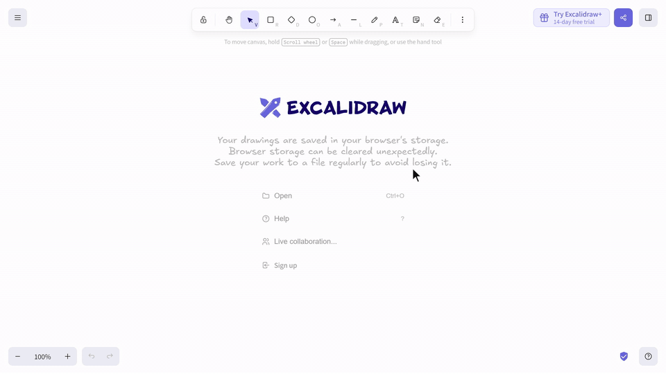
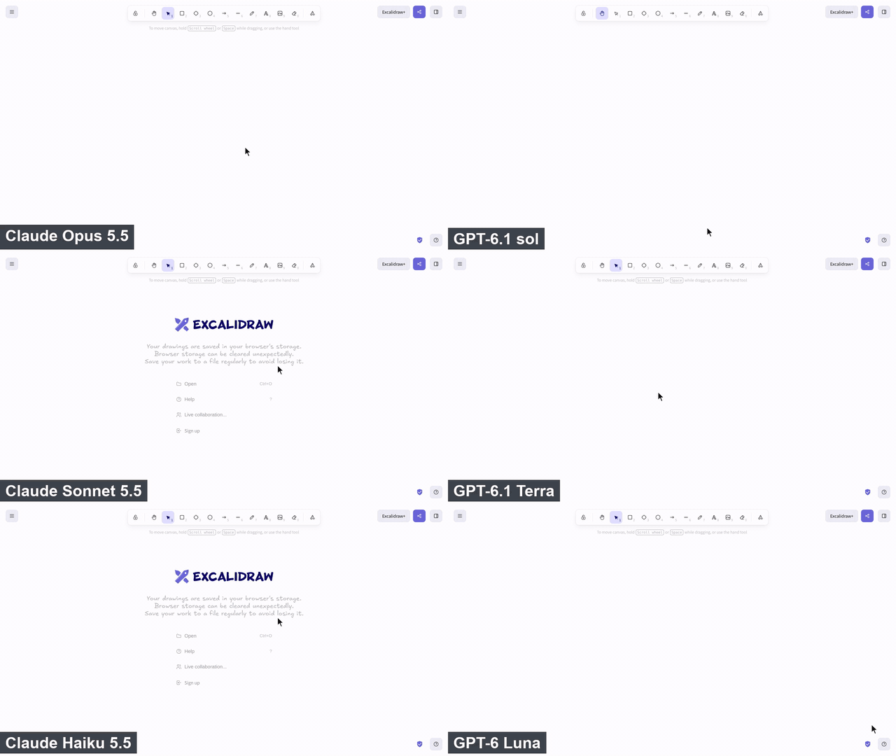
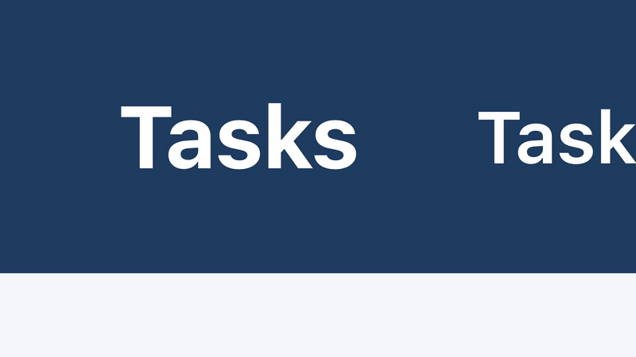
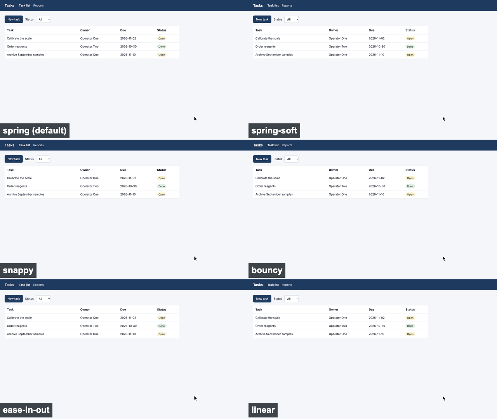
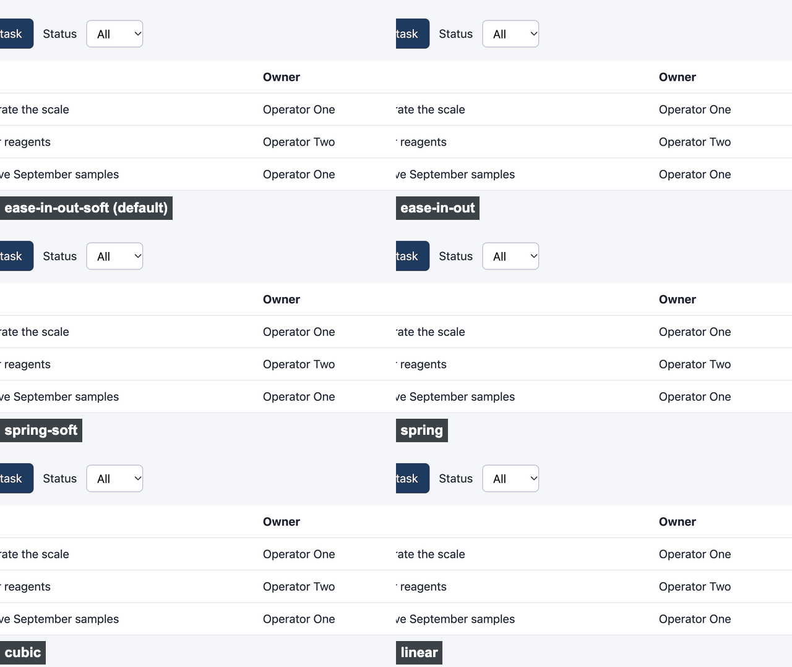
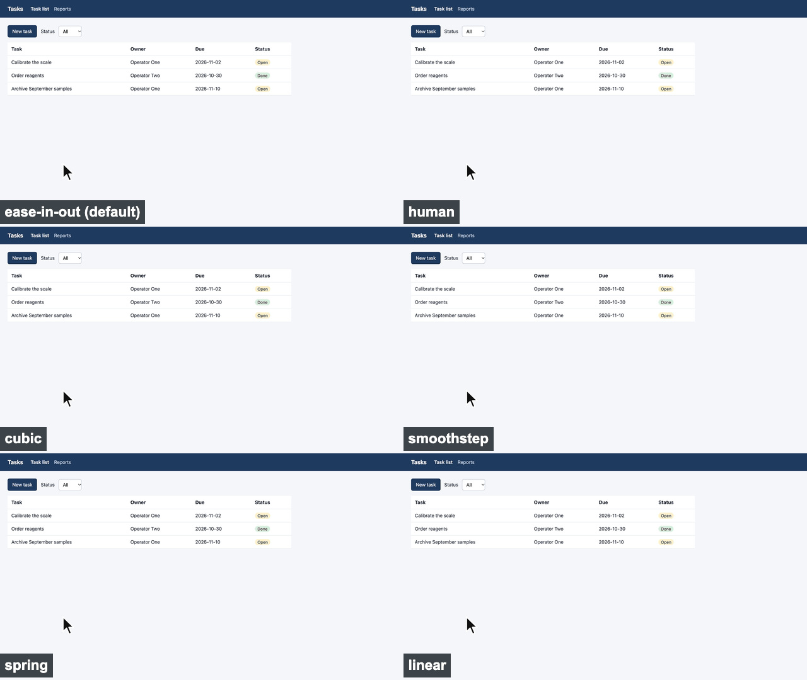

# demorec

Scripted demo videos of web applications.

- An agent (Claude Code, Codex) writes the demo for you.
- It needs two inputs:
  - a description of the app (`app.md`)
  - what you want to show (`brief.md`)
- It records the demo in a headless browser.
- It checks the result frame by frame against your brief.
- Everything runs on your computer.



- Recorded by demorec on [excalidraw.com](https://excalidraw.com) from
  [this brief](projects/excalidraw/demos/first-diagram/brief.md).
- The cursor, timing and chapters come from [the scene](projects/excalidraw/demos/first-diagram/scene.py)
  that Claude Opus 5.5 wrote in Claude Code, working only from `AGENTS.md`.
- It took about 10 minutes, 2 check runs and 2 recordings.
- Full quality: [MP4, 37 s, 2560x1440](docs/media/excalidraw-first-diagram.mp4).

## Model comparison

- Same brief, same prompt, one Docker container each.
- The demo: a recipe for bread with butter and chives in Excalidraw, 8 key moments, about 90 s.
- Shown at 3x speed. Each row pairs a Claude and a GPT model of the same tier.



| | Claude Opus 5.5 | GPT-6.1 sol | Claude Sonnet 5.5 | GPT-6.1 Terra | Claude Haiku 5.5 | GPT-6 Luna |
|---|---|---|---|---|---|---|
| Result | 8 of 8 key moments | 8 of 8 key moments | 8 of 8 key moments | 8 of 8 key moments | 8 of 8 key moments | 8 of 8 key moments |
| Video length (target about 90 s) | 51.8 s | 64.4 s | 93.8 s | 112.9 s | 129.8 s | 140.9 s |
| Agent time | 39 min | 26 min | 25 min | 16 min | 19 min | 24 min |
| Output tokens | 101.5 k | 36.5 k | 75.8 k | 12.7 k | 82.9 k | 65.0 k |

- One run each.
- All six videos were recorded again on 2026-10-28 with the current recorder. The first four
  scenes were written with Czech labels, which were translated afterwards.
- Setup, all six videos, the scenes and the caveats:
  [`docs/bench/2026-10-26-bread-and-butter`](docs/bench/2026-10-26-bread-and-butter/README.md).
- Run your own with `python bench/run.py`.
- It copies your Claude or Codex login file into each Docker container, where the agent runs
  without approvals or sandbox.

## Motion



- A demo can open on a small element, here the title zoomed about 10x, and zoom out to the app.
- Zooms and pans use a critically damped spring by default, Apple's default animation: a quick
  start and a long soft landing.
- The cursor eases in and out (CSS ease-in-out) on a slightly bent path.
- The wheel scrolls at a calm, eased pace, about 500 px/s on average.
- Change all of these in `[motion]` in `project.toml` or per call, `AGENTS.md` lists the options.
- One kind of move per GIF, each tile with another easing, the default top left.
  `docs/media/motion/make_gifs.py` records and builds them again.

Zoom in and out:



Pan while zoomed in:



Cursor:



## Install

- Python 3.11+.
- ffmpeg on PATH.

```bash
python -m venv .venv
.venv/Scripts/pip install -e ".[dev]"      # .venv/bin/pip on Linux and macOS
.venv/Scripts/python -m playwright install chromium
.venv/Scripts/demorec doctor
.venv/Scripts/demorec record projects/example add-task
```

- The last command writes `projects/example/out/add-task/add-task.mp4`.

## Use

- Open the repo in your agent and tell it what you want, for example:

> New project for our app at http://localhost:5173, the repo is in ../myapp. I want a 1-minute
> demo for lab managers that shows how an order gets priced.

- The agent follows `AGENTS.md`:
  - It fills `app.md` from your app's repo.
  - It writes the brief with you and waits for your confirmation.
  - It writes, checks and records the scene.
- You review the video.
- `scene.py`, `helpers.py` and the `[recording] before` command run as normal code on your
  computer. Only record projects you trust.

## What you get per demo

In `projects/<app>/out/<demo>/`:

- The MP4.
- `chapters.vtt`: one chapter per key moment of the brief.
- `keyframes/`: the last frame of every chapter.
- `contact.jpg`: an overview grid.
- `result.json`.

## How it records

- Playwright drives headless Chrome.
- Frames come from the Chrome DevTools screencast, so recording works with a locked screen and
  in the background.
- A separate process receives the frames, so the scene's own code never holds them back.
- The browser renders at twice its size (`scale` in `project.toml`), a 1280x720 browser gives a
  2560x1440 video with sharp text.
- A drawn cursor follows the scripted mouse.
- `a.zoom(target)` and `a.zoom_out()` move a camera over the recording, for small text on a
  projector. The page layout is never changed.
  - Up to 1.5x (`crop_zoom`), ffmpeg crops and scales the frames.
  - Above it, the browser renders the view magnified, sharp up to `max_zoom` (12x).
- ffmpeg encodes the frames with their real timing to H.264 at 30 fps.
- Not captured, because they are outside the page: native select lists, the file dialog, the
  print dialog and the browser address bar. `AGENTS.md` describes the workarounds.

## Tests

```bash
.venv/Scripts/pytest
```

## License

- MIT, see `LICENSE`.
